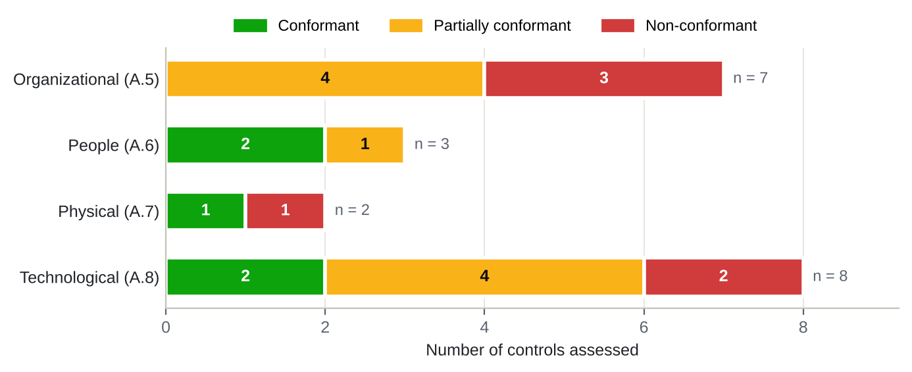
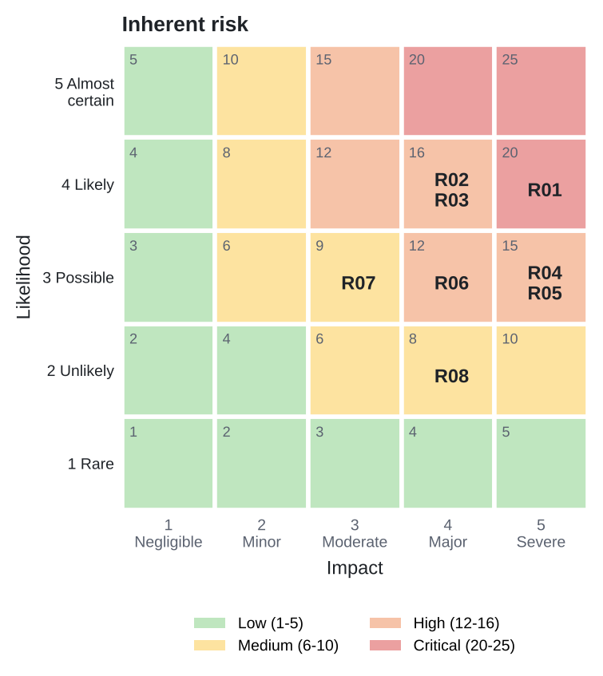
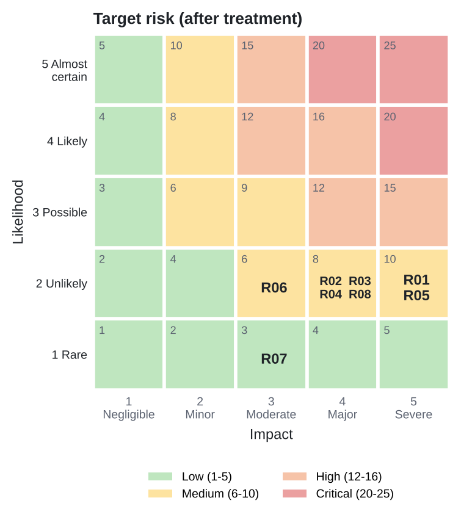

# ISO/IEC 27001:2022 Security Controls Gap Assessment: SecurePay Technologies

A consulting-style **security controls assessment and risk assessment** of a fictional Indian fintech against
**ISO/IEC 27001:2022**. It covers 20 Annex A controls across all four themes, a review of management-system
Clauses 4–10, a risk register with heat maps, a Statement of Applicability (SoA) for all 93 Annex A controls,
and a prioritised 12-month remediation roadmap. The client-style PDF report is generated from CSV data with
Python.

> [!IMPORTANT]
> **Disclaimer.** This is a **self-directed assessment of a fictional organisation**, based on **assumed
> current-state conditions**. It is **not a real client engagement**. SecurePay Technologies, its people,
> systems, incidents and findings are invented. No interviews, system access or evidence sampling were
> performed. Control requirements are paraphrased in plain English. Refer to the licensed ISO/IEC 27001:2022
> and 27002:2022 standards for authoritative text.

**📄 Read the report: [`report/ISO27001_Gap_Assessment_SecurePay.pdf`](report/ISO27001_Gap_Assessment_SecurePay.pdf)**
(35 pages: executive summary, methodology, findings, risk register, SoA, roadmap)

---

## Executive summary

**SecurePay Technologies** (fictional) is a 50-person Bengaluru fintech and RBI-authorised (in-principle)
online Payment Aggregator. It processes about 0.9 million card and UPI transactions a month for 1,200 merchants
on AWS, with an outsourced customer support vendor and no formal ISMS. It is subject to the **DPDP Act 2023**,
**RBI** payment aggregator and data localisation rules, **CERT-In** directions and **PCI DSS**.

| Metric | Result |
|---|---|
| Annex A controls assessed | **20** (Organizational 7, People 3, Physical 2, Technological 8), including **5 of the 11 controls new in 2022** |
| Conformant / Partially conformant / Non-conformant | **5 (25%) / 9 (45%) / 6 (30%)** |
| Conformance score (partial = half credit) | **47.5%** |
| Average maturity (0–5, CMMI-inspired) | **1.7**, "Developing" (12-month target 3.0) |
| Clauses 4–10 | 0 conformant, 4 partially conformant, 3 non-conformant (6, 9, 10) |
| Top risks | **1 Critical, 5 High, 2 Medium**; all reduced to Medium or Low after treatment |
| Statement of Applicability | 90 applicable, 3 excluded (A.7.6, A.7.12, A.8.30) |

**Top three priorities (0–3 months)**

1. **Lock down privileged access and authentication.** Five engineers hold standing AWS admin rights, and the
   root and DB superuser credentials are shared (A.8.2, Critical); the Ops Console and vendor accounts have no MFA (A.8.5).
2. **Build detection and incident response.** Logs are not monitored, there is no IR plan, and a real attack
   took 19 hours to detect, well beyond CERT-In's 6-hour reporting window (A.8.16, A.5.24).
3. **Establish governance and close exploitable application gaps.** Approve the policy, appoint an ISM,
   close 4 open High VAPT findings and rotate 9 secrets leaked in code (A.5.1, A.8.8, A.8.28).

---

## Results

| Control | Name | Theme | Status | Risk |
|---|---|---|---|---|
| A.5.1 | Policies for information security | Organizational | 🟡 Partially conformant | Medium |
| A.5.7 ★ | Threat intelligence | Organizational | 🔴 Non-conformant | Medium |
| A.5.9 | Inventory of information and other associated assets | Organizational | 🟡 Partially conformant | Medium |
| A.5.19 | Information security in supplier relationships | Organizational | 🔴 Non-conformant | High |
| A.5.23 ★ | Information security for use of cloud services | Organizational | 🟡 Partially conformant | Medium |
| A.5.24 | Information security incident management planning and preparation | Organizational | 🔴 Non-conformant | High |
| A.5.34 | Privacy and protection of PII | Organizational | 🟡 Partially conformant | High |
| A.6.1 | Screening | People | 🟢 Conformant | Low |
| A.6.3 | Information security awareness, education and training | People | 🟡 Partially conformant | Medium |
| A.6.7 | Remote working | People | 🟢 Conformant | Low |
| A.7.2 | Physical entry | Physical | 🟢 Conformant | Low |
| A.7.14 | Secure disposal or re-use of equipment | Physical | 🔴 Non-conformant | Medium |
| A.8.2 | Privileged access rights | Technological | 🔴 Non-conformant | **Critical** |
| A.8.5 | Secure authentication | Technological | 🟡 Partially conformant | High |
| A.8.8 | Management of technical vulnerabilities | Technological | 🟡 Partially conformant | High |
| A.8.9 ★ | Configuration management | Technological | 🟡 Partially conformant | Medium |
| A.8.13 | Information backup | Technological | 🟢 Conformant | Low |
| A.8.16 ★ | Monitoring activities | Technological | 🔴 Non-conformant | High |
| A.8.24 | Use of cryptography | Technological | 🟢 Conformant | Low |
| A.8.28 ★ | Secure coding | Technological | 🟡 Partially conformant | High |

★ = new in ISO/IEC 27001:2022

<p align="center">
  <br>
  
  
</p>

### Risk register (top 8)

| ID | Risk | L × I | Rating | Treatment | Owner |
|---|---|---|---|---|---|
| R01 | Compromise of privileged cloud and database accounts | 4 × 5 = 20 | Critical | Mitigate | CTO |
| R02 | Customer personal data exposed through the outsourced support vendor | 4 × 4 = 16 | High | Mitigate | Head of Customer Operations |
| R03 | Exploitation of unpatched vulnerabilities in the payment API and dashboard | 4 × 4 = 16 | High | Mitigate | Engineering Lead |
| R04 | Undetected intrusion and failure to report within CERT-In's 6-hour window | 3 × 5 = 15 | High | Mitigate | CTO (interim ISM) |
| R05 | Regulatory penalty for non-compliance with the DPDP Act, 2023 | 3 × 5 = 15 | High | Mitigate | Head of Legal & Compliance |
| R06 | Business email compromise leading to fraudulent settlement payouts | 3 × 4 = 12 | High | Transfer | CFO |
| R07 | Exposure of production personal data in non-production environments | 3 × 3 = 9 | Medium | Avoid | Engineering Lead |
| R08 | Prolonged outage of the AWS Mumbai region | 2 × 4 = 8 | Medium | Accept | CEO |

---

## Scope

- **Organisation:** SecurePay Technologies (fictional), all 50 staff, plus the outsourced support vendor
  where it handles SecurePay data. Full profile: [`org-profile.md`](org-profile.md).
- **Systems:** payment API, hosted checkout, merchant dashboard, internal Ops Console, AWS production and
  non-production, GitHub CI/CD, Google Workspace, SaaS helpdesk, endpoints.
- **Annex A:** 20 of 93 controls, chosen for relevance to a cloud-hosted payments business, including new 2022
  controls A.5.7, A.5.23, A.8.9, A.8.16 and A.8.28.
- **Clauses 4–10:** high-level review (one line each: status and gap).
- **Out of scope:** technical testing, AWS data centre inspection (inherited controls), formal PCI DSS or DPDP
  compliance opinions.

## Methodology

1. **Plan and scope:** objectives, control selection, rating scales, risk appetite.
2. **Understand context:** business, assets, systems, data flows, regulation, stakeholders.
3. **Assess controls:** paraphrased requirement vs assumed current state; evidence an assessor would request;
   conformance status; maturity (0–5); gap; gap risk rating; recommendation.
4. **Assess risk:** asset–threat–vulnerability scenarios; **risk = likelihood (1–5) × impact (1–5)**; bands
   Low 1–5, Medium 6–10, High 12–16, Critical 20–25; treatment (mitigate / transfer / avoid / accept) against
   the assumed risk appetite (scores of 12 or more must be treated).
5. **Report and plan:** SoA for all 93 controls; roadmap in three phases (0–3, 3–6, 6–12 months) with effort,
   owner and success measures.

| Status | Meaning |
|---|---|
| Conformant | Control designed and operating as required; minor observations at most |
| Partially conformant | Exists in part or informally; significant elements missing or inconsistent |
| Non-conformant | Absent or ineffective; requirement not met |

---

## Repository structure

```
iso27001-gap-assessment/
├── README.md                    # this page
├── org-profile.md               # fictional organisation profile
├── data/
│   ├── controls.csv             # 20 assessed controls (requirement, state, evidence, status, gap, risk, fix)
│   ├── clauses.csv              # Clauses 4–10 review
│   ├── risk-register.csv        # top 8 risks with L × I scoring, treatment, owner, target risk
│   ├── soa.csv                  # Statement of Applicability, all 93 Annex A controls
│   ├── roadmap.csv              # remediation roadmap (0–3, 3–6, 6–12 months)
│   └── assumptions.csv          # documented assumptions
├── scripts/
│   └── build_report.py          # builds charts (matplotlib) and the PDF (reportlab) from the CSVs
├── report/
│   ├── ISO27001_Gap_Assessment_SecurePay.pdf
│   └── charts/                  # conformance by theme, maturity, risk heat maps, SoA status
├── docs/
│   └── study-guide.md           # interview preparation guide
└── requirements.txt
```

## Rebuild the report

```bash
python -m venv .venv && source .venv/bin/activate   # Windows: .venv\Scripts\activate
pip install -r requirements.txt
python scripts/build_report.py --author "Your Name"
```

The script checks the data (93 SoA rows, 20 controls, risk scores = L × I) and then writes the charts and PDF.
Edit any CSV and re-run; the report, tables and charts update together.

## Skills demonstrated

ISO/IEC 27001:2022 (Clauses 4–10, Annex A, SoA) · security controls assessment · risk assessment and treatment ·
cloud security (AWS) · third-party risk · DPDP Act 2023, RBI, CERT-In, PCI DSS context · remediation planning ·
Python reporting automation (reportlab, matplotlib)

---

*Self-directed academic and portfolio project. Fictional organisation; not a real client engagement.
ISO/IEC 27001 is a standard of ISO and IEC; no text from the standard is reproduced here.*
